# 新方案：模型驱动的近场波束设计、贝叶斯跟踪与对比实验

2026 年 11 月 18 日

新方案的代码在 `nfbeam/`，旧方案 `direct_network/` 保留为对照。所有实验都在旧方案留出的 **16 个未见几何场景**上做，每个场景 5 条与旧实验相同的运动轨迹，每条 101 帧（帧长 20 ms）。所有策略在同一次运行里共用轨迹、增益、多径相位、噪声和反馈丢包样本，构成配对比较。区间是按场景配对重采样得到的 95% 区间。**结论仍然全部来自二维标量仿真和代理模型，没有实测数据。**

## 1. 旧方案的问题与对应改动

| 旧方案的问题 | 新方案的处理 | 验证实验 |
| --- | --- | --- |
| 深遮挡一律用网络输出，24% 的位置比聚焦差，最差 5% 低于 −74% | 不再用学习网络。按物理模型在线优化波束，并与聚焦波束比较期望功率，取较优者；可选在帧内用两个导频验证，由接收机选强者 | E1、E2、E3 |
| 跨场景网络离离线参照差 186% | 精确线性信道算子：新几何只需约 0.9 s 构建一次，之后在线直接优化，没有泛化差距 | E1 |
| 依赖精确已知的障碍物几何 | 稳健设计：对位置后验和 9 个几何假设取期望功率；用测量在线更新几何假设的权重；实测时用校准流程估计几何 | E2、E3、E6 |
| 被动路线在深遮挡几乎不可用，不做背景校准时全是虚警 | 距离门把障碍物回波和收发泄漏压到旁瓣；用能绕过遮挡的波束照射；利用数据波形的回波；接收机反射率作为未知状态一起估计 | E4 |
| 深遮挡链路弱，约 64% 的帧低于 1 bit/s/Hz | 波束只能缓解，不能根治。给出缺多少链路余量；把孔径作为单独的实验维度，分开孔径、电尺寸和距离孔径比各自的影响 | E7、E8 |
| 实验口径不一致 | 统一框架：同一组未见场景、同一组轨迹、同样的资源预算和配对统计 | 全部 |
| 对照组偏弱 | 加入码本波束训练、在线 Airy、已知真实位置的参照，以及振幅和相位都可调时的物理上界 | E1、E3 |
| 设计太慢，跟不上 20 ms 帧 | 无矩阵的稳健算子 + 从上一帧波束热启动几步迭代；可选现场建表。两者都只依赖当前场景的信道模型，不需要离线训练，换场景直接可用 | E9 |
| 没有测试 | `tests/` 共 14 项单元测试，包括"时延感知重滤波与按顺序处理结果一致""无矩阵算子与稳健 Gram 矩阵一致" | — |

## 2. 系统设计

**信道算子**（`nfbeam/channel.py`）。发射孔径是 160 个半波长阵元。角谱传播和吸收掩膜对源场都是线性的，所以每个阵元单位激励只需传播一次，就得到矩阵 $H$。任意波束 $w$ 在接收孔径 $x$ 处的功率是二次型 $P=w^H G(x)\,w$。与原传播引擎相比，误差在 1%–4% 以内，来源是阵元离散化。

**波束设计**（`nfbeam/design.py`）。设计目标是最大化 $w^H A w$，其中 $A=\sum_g \pi_g \sum_x p(x)\,G_g(x)$，即对位置后验 $p(x)$ 和几何假设权重 $\pi_g$ 取期望。提供两种波束族：

- **逐阵元纯相位**：迭代 $w\leftarrow e^{j\angle(Aw)}$，对半正定的 $A$ 单调不减。每个阵元有自己的功放、功率受限时，最优解就落在纯相位上，所以这是相控阵的相关最优。
- **在线 Airy 搜索**：在 $(B,F,\theta)$ 两个弯曲方向的分支上做有界 Powell 搜索，适用于只能生成 Airy 波束的硬件。E8 用的 `airy_search_wide` 先做对数网格再细化，适用于任意孔径和距离。
- **实时版**：不显式构造 $A$，而是用 $Aw=\sum_g \pi_g \overline{H_g}\,(q\odot H_g^{T}w)$ 直接计算矩阵–向量积。位置后验很宽时，把接收样本抽稀到最多 900 列。每帧只从"上一帧波束"和"聚焦波束"中较好的一个出发迭代 5 步（第一帧 20 步）。接收机每帧只移动零点几毫米，上一帧的最优解已经很接近，几步就能跟上。可选再加一个初值，来自现场建的表：几何估计出来后，在 1 mm 网格上为当前场景算一张绕射波束表。

**跟踪**（`nfbeam/tracking.py`）。网格贝叶斯滤波，状态是位置 0.5 mm × 速度 3 cm/s，被动模式再加一维反射率。所有观测都转成似然，不设检出门限。似然带重尾，对模型误差不敏感。迟到的反馈从当时存档的先验重新滤波。

**感知**（`nfbeam/sensing.py`）：
- **协作模式**：沿用旧实验的 4 子孔径导频代理模型，包含公共增益 0.75 dB、0.15 倍相干次径和复噪声，保证与旧结果可比。
- **非协作模式**：在旧的双程平方律代理模型上加入：
  - 有限带宽距离门：4 GHz，Hann 窗，旁瓣下限 −40 dB；
  - 障碍物回波（功率反射率 0.1）、收发泄漏（−40 dB）和杂波漂移；
  - 数据波形回波，其匹配滤波噪声随载荷时长线性下降。

**帧协议**（`nfbeam/link.py`）。每帧固定有参考符号和反馈各 0.1 ms。后验标准差超过 5 mm 时做 9 束重捕获扫描，每束 0.1 ms。反馈可以有时延（按帧计）和丢包（独立或 Gilbert–Elliott 突发）。

**对照策略**：

| 名称 | 内容 |
| --- | --- |
| 原方案 | 卡尔曼 + 模板门控 + 连续两帧缺测量就补扫 + 学习型 Airy 网络。零时延时的时序与旧实验完全一致 |
| 码本波束训练 | 每帧扫 17 个绕射波束，用测得最强的一个 |
| 聚焦 + 新跟踪 | 新跟踪器配聚焦波束，用于分离"跟踪"与"波束设计"各自的贡献 |
| 真实位置参照 | 已知真实位置和真实几何的纯相位最优，不计感知开销 |

## 3. 实验结果

### E1 已知位置：波束本身能做到什么

16 个未见场景、800 个深遮挡位置，位置和几何都已知。

| 波束 | 相对聚焦平均提升 | 优于聚焦的比例 | 5% 分位 | 最差点 | 每次设计耗时 |
| --- | ---: | ---: | ---: | ---: | ---: |
| 原方案学习网络 | +56% | 76.5% | −75% | −96% | 1.8 ms |
| 离线参照 Airy（旧标签） | +127% | 100% | +34% | +12% | — |
| 在线 Airy 优化 | +132% | 99.9% | +34% | 0% | 232 ms |
| 逐阵元纯相位 | **+202%** | **100%** | **+45%** | **+38%** | 61 ms |
| 2 bit 相位量化 | +153% | 100% | +21% | +15% | 32 ms |
| 物理上界（振幅和相位都可调） | +966% | — | — | — | — |

在线 Airy 优化追平并略微超过了旧的离线参照，跨场景差距没有了。逐阵元纯相位再高约 30%。物理上界达不到：它要求在阵元之间重新分配功率，而每个阵元功率受限的相控阵做不到。

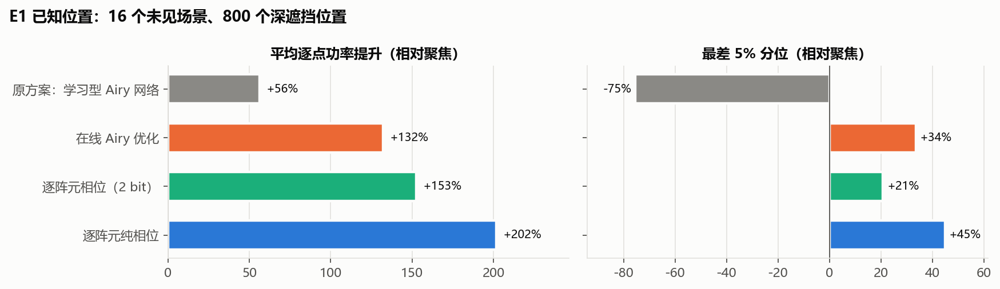

### E2 位置与几何误差下的稳健性

设计只知道估计位置 $\hat x=x+e$（$e\sim N(0,\sigma)$）和名义几何。真实几何有三种：匹配；失配（横移 ±4 mm、宽度 ±6%，不落在假设网格上）；强失配（再加上纵向 ±5 mm 和厚度 ±15%）。下表是相对"在估计位置聚焦"的 **5% 分位**：

| 几何 | σ | 原方案网络 | 名义模型纯相位 | 稳健纯相位 |
| --- | --- | ---: | ---: | ---: |
| 匹配 | 1 / 3 / 6 mm | −70 / −81 / −87% | +42 / +33 / +17% | +42 / +31 / +14% |
| 失配 | 1 / 3 / 6 mm | −77 / −83 / −62% | +6 / 0 / −13% | +9 / +3 / −16% |
| 强失配 | 1 / 3 / 6 mm | −84 / −82 / −80% | −7 / −11 / −22% | −1 / −8 / −24% |

- **几何匹配**：失败尾部基本消除。σ=6 mm 时，稳健纯相位的最差点仍比聚焦高 0.7%。
- **几何失配**：尾部从 −60% 到 −87% 缩小到 −24% 到 +9%，但没有完全消除，平均提升仍在 +115% 到 +135%。
- **稳健设计的单独作用**：一次性的静态设计里，对几何假设取平均只带来很小的改进；稳健 Airy 还不如名义模型的纯相位。所以几何失配要靠下面的动态闭环解决：用测量更新几何权重，并用导频验证。

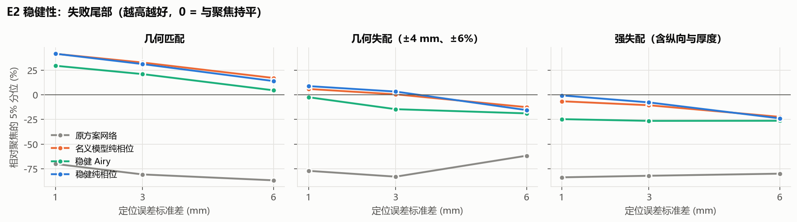

### E3 协作接收机端到端

深遮挡有效频谱效率，单位 bit/s/Hz；括号内是相对原方案的变化和 95% 区间。

| 条件 | 原方案 | 码本训练 | 新方案 | 新方案 + 验证 | 新方案（Airy 族） | 真实位置参照 |
| --- | ---: | ---: | ---: | ---: | ---: | ---: |
| 基准 | 1.18 | 1.35 | **1.41**（+20.9% [15.9, 26.3]） | 1.43（+22.6%） | 1.34（+14.2%） | 1.51 |
| 几何失配 | 1.06 | 1.22 | **1.39**（+33.3% [27.2, 39.7]） | 1.40（+34.4%） | 1.31（+25.3%） | 1.49 |
| 强失配 | 0.97 | 1.14 | **1.28**（+33.1% [27.1, 39.6]） | 1.29（+33.8%） | 1.23（+27.0%） | 1.48 |
| 导频噪声 +6 dB | 1.17 | 1.33 | **1.41**（+22.4% [17.3, 28.3]） | 1.42（+23.2%） | 1.34（+15.2%） | 1.51 |

基准条件下的深遮挡细节：

| 指标 | 原方案 | 新方案 | 码本训练 |
| --- | ---: | ---: | ---: |
| 低于 1 bit/s/Hz 的帧 | 45.0% | 34.8% | 34.8% |
| 位置平均误差 | 3.97 mm | 2.85 mm | 5.97 mm |
| 失锁帧（误差超过 10 mm） | 6.9% | 2.0% | 17.6% |
| 扫描帧 | 20.3% | 1.6% | 100% |

其他条件下的失锁帧：

| 条件 | 原方案 | 新方案 |
| --- | ---: | ---: |
| 强失配 | 15.5% | 7.3% |
| 导频噪声 +6 dB | 14.3% | 1.1% |

非遮挡区的频谱效率也从 2.84 提高到 3.12 bit/s/Hz。

**增益来源。** "新跟踪器 + 聚焦波束"在深遮挡比原方案还低 3%–17%，所以增益几乎全部来自波束设计，而不是跟踪。新方案与真实位置参照的差距是 5%–14%。

**验证的作用。** 帧内导频验证要多付 0.2 ms，换来的提升只有约 1%，失锁略低。在强失配下验证会偶尔选错，位置 P95 反而变大。只有当几何误差大到模型本身不可信时，验证才有明显价值。

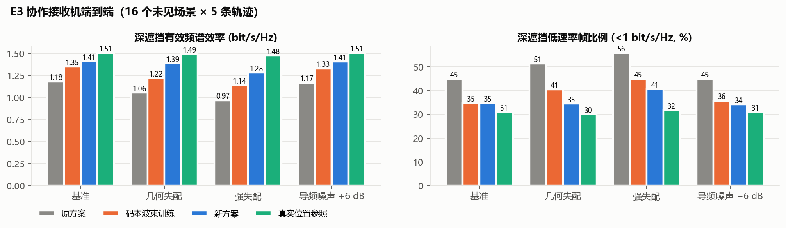

### E4（缺口 1）非协作接收机：数据波形回波定位

所有策略用同一个跟踪器和同一种数据波束，只有感知方式不同，发射资源相同。下表是深遮挡结果（基准：4 GHz 带宽、无背景校准）：

| 感知方式 | 频谱效率 | 位置平均误差 | 失锁帧 | 最长失锁 | 专用照射帧 |
| --- | ---: | ---: | ---: | ---: | ---: |
| 每帧 21 束聚焦照射（旧前端） | 1.29 | 3.3 mm | 7.4% | 48 ms | 100% |
| 每帧 9 束绕射照射 | 1.40 | 3.0 mm | 5.2% | 33 ms | 100% |
| 数据波形回波 + 距离门 | **1.42** | 3.9 mm | 8.0% | 56 ms | **12%** |
| 数据波形回波，无距离门 | 1.36 | 6.6 mm | 19.5% | 104 ms | 87% |

- **相对 21 束聚焦照射的深遮挡效率**：
  - 数据波形回波：**+10.2%**，区间 [8.3, 11.9]；几何失配下 +8.9%。
  - 9 束绕射照射：+8.6%。
- **代价**：数据波形回波只有一个波束方向，深遮挡的定位误差和失锁比 9 束专用照射略高，节省下来的扫描时间多于这部分损失。
- **距离门的作用**：
  - 背景估计过期时，无距离门的 21 束照射失锁达 70%，频谱效率跌到 0.75。
  - 有距离门的数据波形回波不受影响：效率 1.42，失锁 7.3%，而且不需要背景校准。
  - 带宽降到 1 GHz 时，结果基本不变（效率 1.44）。

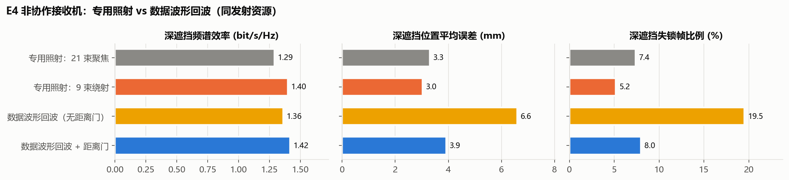

### E5（缺口 2）反馈时延与丢包

时延取 0、1、3 帧，丢包取无、独立 20%、Gilbert–Elliott 突发三种。下表是深遮挡结果：

| 时延 | 丢包 | 频谱效率：原方案 / 不处理时延 / 时延感知 | 失锁帧：原方案 / 不处理时延 / 时延感知 | 最长失锁 (ms)：同序 |
| --- | --- | --- | --- | --- |
| 0 | 无 | 1.18 / 1.44 / 1.41 | 6.9 / 2.6 / 2.0% | 40 / 17 / 13 |
| 1 | 突发 | 1.14 / 1.43 / 1.43 | 19.9 / 9.2 / 3.7% | 122 / 59 / 21 |
| 3 | 无 | 1.08 / 1.35 / 1.39 | 34.7 / 35.4 / 12.1% | 231 / 218 / 39 |
| 3 | 独立 20% | 1.06 / 1.35 / 1.38 | 37.5 / 34.3 / 12.0% | 244 / 213 / 42 |

- **相对原方案**：时延感知的新方案在所有 9 种组合下都更好，深遮挡效率提升从 +21%（时延 0）到 +35%（时延 3、丢包 20%），区间都在 0 以上。
- **相对"不处理时延"**：
  - 时延 3 帧：效率 +2.7% 到 +3.2%，区间都在 0 以上；最长失锁从约 215 ms 降到约 40 ms。
  - 时延 0 帧：效率反而低 2%（区间 [−3.0, −1.0]），因为它更频繁地补扫。
- **代价**：时延 3 帧时，后验持续变宽，补扫比例升到 62%–68%。补扫门限还可以按时延自适应调整，这是可以继续改进的地方。

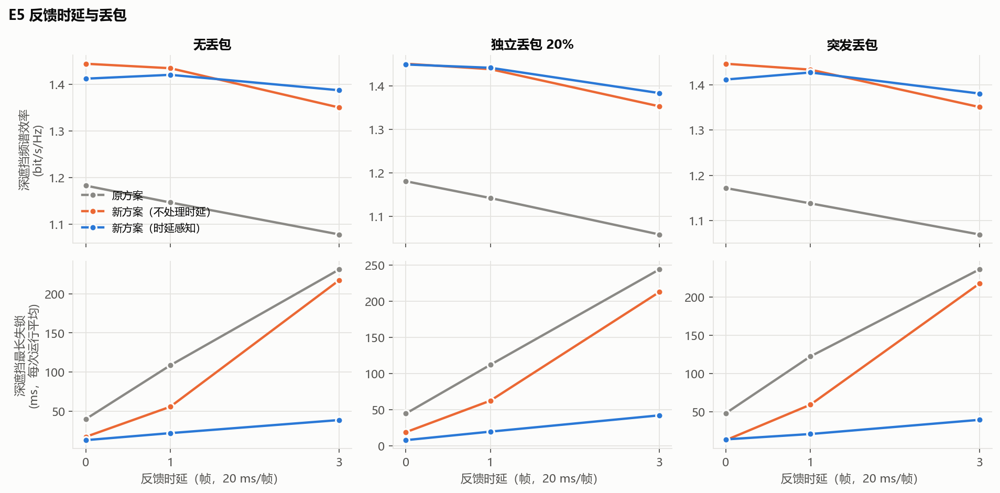

### E6（缺口 3）仿真与测量对照、模型校准 —— 合成测量，不是实测

数字孪生的设置：

- **更细的传播网格**；
- **隐藏的几何偏差**：横移 ±5 mm、宽度 ±8%、纵向 ±4 mm、厚度 ±15%；
- **阵元误差**：平滑相位误差、10° 随机相位误差、1 dB 幅度误差；
- **3 bit 移相器**。

测量方案：每个场景 40 个已知位置 × 18 个探测波束 × 4 个子孔径，一半位置用于校准，另一半用于评价。

| 指标（留出位置，16 个场景平均） | 名义模型 | 校准后模型 |
| --- | ---: | ---: |
| 功率预测误差 RMSE（全部 / 深遮挡） | 4.68 / 4.75 dB | **3.21 / 3.21 dB** |
| 深遮挡有效频谱效率：预测减测量（偏差 / RMSE） | +0.28 / 0.48 | **+0.03 / 0.06** |
| 深遮挡测得频谱效率（聚焦为 0.76） | 1.03 | **1.36**（硬件误差完全已知时为 1.39） |

几何恢复的平均绝对误差：横移 0.20 mm、宽度比例 0.5%、纵向 1.15 mm、厚度比例 6.5%。校准对波束效果影响最大：深遮挡测得效率提高 32%，与"硬件误差完全已知"只差 2.5%。剩余约 3 dB 的预测误差，主要来自每次读数的增益起伏和不可辨识的逐阵元随机误差。数据格式和换用实测数据的步骤见 [实测对照与模型校准.md](实测对照与模型校准.md)。

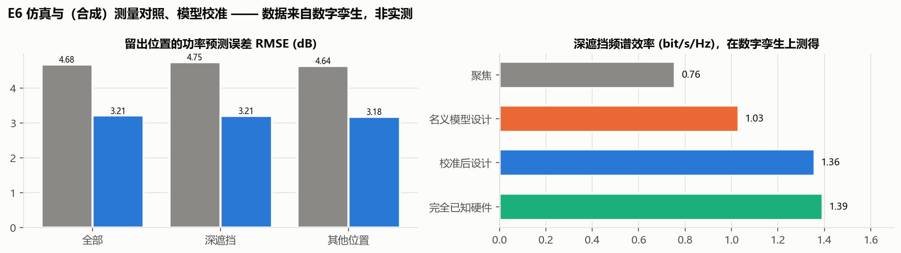

### E7 链路预算与孔径

位置已知，速率取理想值，不计开销；噪声按 0.2 m 参考链路固定。

| 发射孔径 | 聚焦 | 在线 Airy | 逐阵元纯相位 |
| --- | ---: | ---: | ---: |
| 0.2 m：深遮挡平均频谱效率 | 1.09 | 1.48 | 1.59 |
| 0.2 m：低于 1 bit/s/Hz 的位置 | 46% | 33% | 29% |
| 0.2 m：让 90% 位置达到 1 bit/s/Hz 还需的余量 | 12.1 dB | 6.3 dB | **4.4 dB** |
| 0.3 m：深遮挡平均频谱效率 | 2.54 | 2.60 | 2.91 |
| 0.4 m：深遮挡平均频谱效率 | 3.17 | 3.17 | 3.42 |

在 0.2 m 孔径下，最好的纯相位波束仍差约 4.4 dB。这部分只能靠链路预算解决，比如发射功率、接收增益或编码方式。孔径扩大到 0.3 m 时，所有位置都超过 1 bit/s/Hz。原因是孔径宽于障碍物后，几何遮挡本身减弱了，这些位置就不再是"深遮挡"。由此可见，"深遮挡链路弱"主要是孔径相对障碍物尺寸、以及链路余量的问题，不是波束算法的问题。

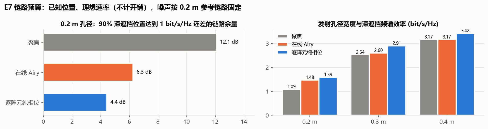

E7 只是在同一房间里放大了孔径，深遮挡集合也没有随孔径重新划分，所以结论里混进了"阴影本身变浅"的效果。E8 把孔径单独作为实验维度重新做了一遍，E7 保留作历史记录。E7 中 0.4 m 下 Airy 与聚焦完全相同，这一点已经用 $(B,F,\theta)$ 全网格搜索核对过：最好的 Airy 也只有聚焦的 0.993 倍，所以不是搜索失败。

### E8 孔径维度：孔径、电尺寸与距离孔径比

**为什么要单独做。** 参考论文用 20 cm 孔径（120 GHz，160 个半波长阵元，80λ），理由是"能放进一张 US Letter 纸"，接收孔径 2.5 cm，仿真区域 0.5 m × 0.5 m。本项目与它一致。相关工作的设置如下：

| 工作 | 频率 | 发射孔径 | D/λ | 距离 | z/D | 是否比较孔径 |
| --- | --- | --- | ---: | --- | ---: | --- |
| 参考论文（Nat. Commun. 2025） | 120 GHz | 20 cm | 80 | ≈0.37 m | 1.9 | 否 |
| Curving THz links（Commun. Eng. 2024），实验器件 | 200 GHz | 9.75 cm | 65 | 0.18 m | 1.8 | 只有定性结论：孔径越大，能弯得越紧 |
| Zhao/Han/Björnson，arXiv 2603.13866 | 140 GHz | 27.3 cm（256 阵元） | 128 | 3 m | 11 | 否 |
| 物理引导神经网络 Airy，arXiv 2608.04388 | 140 GHz | 27.3 cm | 128 | 2.5–4 m | 9–15 | 否 |
| Single→Multi-Airy，arXiv 2607.07278 | 100 GHz | 1 m | 333 | 5 m | 5 | 否 |
| 全息 Airy，arXiv 2605.16057 | 100 GHz | 20 cm | 67 | ≈2.4 m | 12 | 否 |
| 近场波束整形实证，arXiv 2609.28400 | 150 GHz | 50 cm | 250 | 1 m | 2 | 否，只扫了障碍物宽度 |
| Airy 近场波动光学分析，arXiv 2508.13714 | 以波长计 | 10–300λ | 10–300 | 40–290λ | — | 是：所需孔径随距离平方增长；遮挡链路里 Airy 的优势要求"未被遮挡的那部分孔径"足够大 |

说明：表中部分 arXiv 数字来自 HTML 全文的自动摘录，引用前应核对 PDF。Bessel 自修复波束那篇（Commun. Eng. 2023）没能读到正文，未列入。

相关工作的孔径大多在 65–333λ，距离与孔径之比 z/D 在 2–25；参考论文和本项目处在 z/D ≈ 2 的极近距离端。除 2508.13714 外，没有工作把孔径作为变量系统比较。

**设计。** 只改孔径 D 会同时改变"障碍物挡住多大比例的孔径"，所以做了三组扫描来分离各个因素：

| 扫描 | 改变什么 | 保持什么 | 取值 |
| --- | --- | --- | --- |
| 同一房间 | 只改 D | 场景实物不变 | 5–50 cm（40–400 阵元） |
| 等比例缩放 | 所有长度（孔径、障碍物、距离、接收位置与接收孔径）随 D 等比例缩放 | 几何遮挡与 z/D 不变，只改电尺寸 D/λ | D/λ = 20–200 |
| 距离缩放 | D 固定 0.2 m，所有纵向长度（障碍物位置与厚度、接收距离）乘以 t | 几何遮挡与 D/λ 不变，只改 z/D | z/D = 0.9–15 |

每组都用 16 个未见场景、每个场景 41 个接收位置，位置和几何已知。比较聚焦、在线 Airy、逐阵元纯相位和幅相上界。

原来的 Airy 搜索是按 0.2 m 孔径、0.36 m 距离调的，离这个几何远了就会漏掉最优：t = 8 时，网格能找到聚焦的 1.79 倍，原搜索只有 1.00 倍。因此 E8 用新写的 `airy_search_wide`：先在对数间隔的 $|B|$（按 0.2 m/D 缩放）、0.3–1.9 倍焦距、±20° 的网格上打分，再用 Powell 细化，并保留原搜索的结果作为候选。E1–E7 仍用原搜索，结果可以原样复现。

**指标。** 都不依赖功率归一化：
- 相对聚焦的增益：取 dB 中位数。逐点平均会被聚焦功率接近零的个别位置放大到上万个百分点，没有意义。
- 遮挡损耗：接收功率相对同一位置无遮挡聚焦链路的 dB 值。
- "同一房间"一组另外报告绝对频谱效率，噪声按 0.2 m 参考链路固定（E7 口径），分"总发射功率固定"和"单阵元功率固定"两种。

**同一房间。** 比较对象是 0.2 m 孔径下属于深遮挡的那些位置：

| 发射孔径 | 5 cm | 10 cm | 15 cm | 20 cm | 30 cm | 40 cm | 50 cm |
| --- | ---: | ---: | ---: | ---: | ---: | ---: | ---: |
| 深遮挡位置占比（按该孔径重新划分） | 77% | 63% | 47% | 35% | 1.7% | 0 | 0 |
| 纯相位相对聚焦的增益中位数 | 23.6 dB | 16.1 dB | 8.5 dB | 3.7 dB | 1.3 dB | 0.8 dB | 0.6 dB |
| 纯相位的遮挡损耗中位数 | −30.0 dB | −24.6 dB | −19.8 dB | −11.0 dB | −5.1 dB | −3.2 dB | −2.4 dB |
| 聚焦的遮挡损耗中位数 | −53.5 dB | −42.9 dB | −28.4 dB | −14.8 dB | −6.1 dB | −4.1 dB | −3.0 dB |
| 纯相位频谱效率，总功率固定 | 0.03 | 0.09 | 0.41 | 1.38 | 2.87 | 3.43 | 3.66 |
| 纯相位频谱效率，单阵元功率固定 | 0.01 | 0.04 | 0.33 | 1.38 | 3.39 | 4.36 | 4.91 |
| 纯相位下低于 1 bit/s/Hz 的位置（总功率固定） | 100% | 100% | 92% | 38% | 0 | 0 | 0 |

在同一个房间里，障碍物宽 8–10 cm。孔径小于障碍物时，阴影很深，整形能挽回十几到二十几 dB，但链路仍然不可用。孔径大约是障碍物的 3 倍（0.3 m）以后，深遮挡消失，聚焦已经接近最好，整形只剩约 1 dB。**波束整形真正有用的是 0.15–0.2 m 这一段：孔径与障碍物相当，阴影深但还能绕过去。** 参考论文的 20 cm 正好落在这一段。

**等比例缩放**（只改电尺寸，几何遮挡和 z/D 不变；深遮挡位置）：

| D/λ | 20 | 40 | 60 | 80 | 120 | 160 | 200 |
| --- | ---: | ---: | ---: | ---: | ---: | ---: | ---: |
| 在线 Airy 相对聚焦 | 4.2 dB | 3.6 dB | 3.2 dB | 3.2 dB | 3.2 dB | 3.3 dB | 3.5 dB |
| 纯相位相对聚焦 | 4.9 dB | 4.1 dB | 3.9 dB | 3.7 dB | 4.0 dB | 4.5 dB | 5.3 dB |
| 幅相上界相对聚焦 | 8.2 dB | 8.9 dB | 9.4 dB | 9.9 dB | 10.4 dB | 10.7 dB | 11.0 dB |
| 纯相位的遮挡损耗 | −14.8 dB | −13.3 dB | −12.1 dB | −11.0 dB | −9.3 dB | −7.9 dB | −6.7 dB |
| 聚焦的遮挡损耗 | −19.9 dB | −17.5 dB | −15.9 dB | −14.8 dB | −13.1 dB | −12.4 dB | −12.1 dB |

电尺寸越大，同样几何下的遮挡损耗越小：D/λ 从 20 增大到 200，纯相位和聚焦的遮挡损耗都改善约 8 dB（分别为 8.1 dB 和 7.8 dB）。整形相对聚焦的收益基本稳定在 4–5 dB，在线 Airy 稳定在约 3.3 dB。幅相上界随电尺寸继续增大，说明孔径越大，"振幅也可调"的潜力越大，纯相位只拿到上界的 30%–50%。

**距离缩放**（D = 0.2 m、D/λ = 80，只改 z/D；深遮挡位置）：

| z/D | 0.9 | 1.9 | 3.8 | 7.5 | 15 |
| --- | ---: | ---: | ---: | ---: | ---: |
| 在线 Airy 相对聚焦 | 3.3 dB | 3.2 dB | 2.3 dB | 2.9 dB | 2.6 dB |
| 纯相位相对聚焦 | 4.1 dB | 3.7 dB | 4.0 dB | 6.4 dB | **13.2 dB** |
| 纯相位达到幅相上界的比例 | 24% | 27% | 35% | 69% | 99% |
| 纯相位的遮挡损耗 | −8.8 dB | −11.0 dB | −13.6 dB | −13.9 dB | −7.6 dB |
| 聚焦的遮挡损耗 | −13.0 dB | −14.8 dB | −17.7 dB | −20.6 dB | −20.9 dB |

这组结果和相关文献的关系最大。相关文献大多在 z/D = 5–15，在这个区间里：
- 聚焦的遮挡损耗越来越大；
- 逐阵元纯相位相对聚焦的收益从约 4 dB 增长到 13 dB，并且几乎达到幅相上界；
- **Airy 族的收益始终停在约 3 dB**。三参数的 Airy 族在远距离上表达能力不够，逐阵元设计的价值反而更大。

这与 2508.13714 的结论一致：所需孔径随距离增长，Airy 的优势取决于"未被遮挡的那部分孔径"。

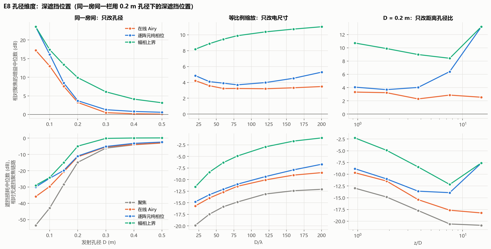

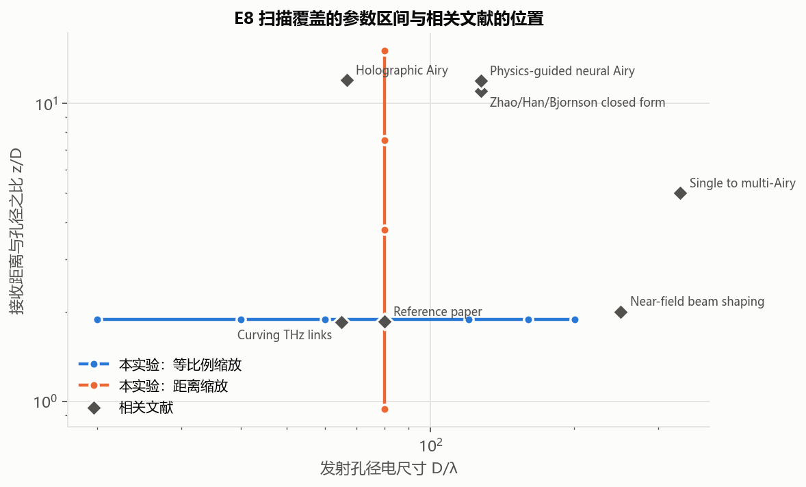

**端到端（E8b）。** 场景、轨迹和噪声与 E3 一致（几何匹配），发射孔径分别为 0.1、0.2、0.3 m。总发射功率和数据噪声按 0.2 m 参考链路固定。统计对象是 0.2 m 孔径下的深遮挡位置：

| 孔径 | 策略 | 有效频谱效率 | 低于 1 bit/s/Hz 的帧 | 失锁帧 | 扫描帧 |
| --- | --- | ---: | ---: | ---: | ---: |
| 0.1 m | 贝叶斯跟踪 + 聚焦 | 0.01 | 100% | 13.1% | 72% |
| 0.1 m | 新方案（实时版） | 0.09 | 100% | 11.8% | 63% |
| 0.1 m | 真实位置参照 | 0.10 | 100% | — | — |
| 0.2 m | 贝叶斯跟踪 + 聚焦 | 0.97 | 53% | 3.2% | 5.8% |
| 0.2 m | 新方案（实时版） | 1.41 | 35% | 1.9% | 1.5% |
| 0.2 m | 真实位置参照 | 1.51 | 31% | — | — |
| 0.3 m | 贝叶斯跟踪 + 聚焦 | 2.50 | 0.4% | 0.03% | 0.3% |
| 0.3 m | 新方案（实时版） | 2.82 | 0 | 0.03% | 0.6% |
| 0.3 m | 真实位置参照 | 2.87 | 0 | — | — |

实时版相对"聚焦 + 同一跟踪器"的提升，在 0.2 m 时为 +45%（区间 [39%, 53%]），在 0.3 m 时为 +13%（区间 [12%, 15%]），分别达到真实位置参照的 93% 和 98%。0.1 m 孔径下，相对提升的百分比很大，但效率绝对值不到 0.1 bit/s/Hz，链路实际不可用；连真实位置参照也只有 0.10。按单阵元功率固定计算时，0.3 m 的效率进一步升到 3.33。

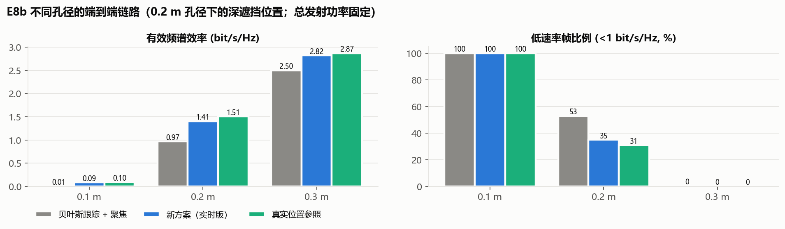

**结论：**
- 波束整形的相对收益在孔径与障碍物尺寸相当时最大。孔径远大于障碍物时，整形空间很小；孔径远小于障碍物时，链路本身不可用。
- 对系统设计而言，0.3 m 孔径（障碍物的约 3 倍）是最直接的出路，增大孔径比改进算法更有效。
- 文献常用的 z/D = 5–15 区间里，逐阵元设计比 Airy 族多出 3–10 dB，不应只在 Airy 族里搜索。

### E9 实时化：不依赖场景的实时设计

**问题。** 上一版的完整设计要现算稳健 Gram 矩阵、从特征向量、聚焦和上一帧三个初值各迭代到收敛，常常超过 20 ms 帧长。"离线为每个场景存一张波束表"的做法换场景就要重做，旧方案"离线训练、跨场景推理"的路线也已经被 E1 否定。

**两种实时版。** 都只用当前场景的信道模型，没有任何离线内容：
1. **热启动**（`proposed_warm`）：无矩阵算子，从上一帧波束和聚焦波束中较好的一个出发，迭代 5 步。
2. **现场建表 + 热启动**（`proposed_table`）：几何估计出来后，在 1 mm 网格上为当前场景现场算一张 221 项的表，表项作为额外的初值。建表单线程平均 3.6 s，最长 4.4 s；表项彼此独立，可以并行，或在几何变化时后台重建，期间用热启动顶上。

计时都是单线程实测，在 12 进程并行的仿真里测得。完整设计本身也因为缓存了发射 Gram 矩阵而变快了（单场景测试中从约 38 ms 降到约 14 ms）。

| 条件 | 策略 | 每帧耗时均值 | 99% 分位 | 最大 | 超过 20 ms 的帧 | 深遮挡频谱效率 | 相对完整设计（深遮挡） |
| --- | --- | ---: | ---: | ---: | ---: | ---: | ---: |
| 几何匹配 | 完整设计 | 14.1 ms | 31 ms | 42 ms | 12.4% | 1.412 | — |
| 几何匹配 | 热启动 | 6.9 ms | 15 ms | 21 ms | 0.01% | 1.407 | −0.1%，区间 [−0.9%, +0.7%] |
| 几何匹配 | 现场建表 + 热启动 | 6.2 ms | 15 ms | 20 ms | 0.02% | 1.411 | −0.1%，区间 [−0.8%, +0.9%] |
| 强失配 | 完整设计 | 14.8 ms | 32 ms | 57 ms | 15.5% | 1.282 | — |
| 强失配 | 热启动 | 6.9 ms | 15 ms | 22 ms | 0.10% | 1.282 | −0.1%，区间 [−1.0%, +0.8%] |
| 时延 3 帧 + 突发丢包 | 完整设计 | 18.3 ms | 73 ms | 115 ms | 23.1% | 1.380 | — |
| 时延 3 帧 + 突发丢包 | 热启动 | 6.6 ms | 16 ms | 30 ms | 0.31% | 1.380 | 0.0%，区间 [−0.4%, +0.3%] |

第一帧没有上一帧可以继承：热启动从聚焦出发迭代 20 步，平均约 28 ms；建表版约 13 ms。

"时延 + 突发丢包"条件下，频繁补扫会让位置后验很宽，完整设计的 99% 分位因此达到 73 ms。实时版通过抽稀接收样本，把这类帧也压到 16 ms。

**阵元数扩展**（场景 64，单进程，后验宽 2 mm，接收机每帧移动 0.6 mm）：

| 阵元数 | 40 | 80 | 160 | 240 | 320 | 400 |
| --- | ---: | ---: | ---: | ---: | ---: | ---: |
| 完整设计 | 0.6 ms | 2.0 ms | 11.8 ms | 22.8 ms | 131 ms | 359 ms |
| 热启动均值 | 0.2 ms | 0.4 ms | 2.4 ms | 6.8 ms | 13.2 ms | 17.3 ms |
| 热启动最大 | 1.0 ms | 2.1 ms | 5.9 ms | 9.4 ms | 18.4 ms | 19.7 ms |
| 热启动功率 / 完整设计功率（最差） | 1.000 | 1.000 | 0.990 | 0.986 | 0.987 | 0.984 |

完整设计里的广义特征分解随阵元数大致按三次方增长，热启动只随阵元数与接收样本数的乘积线性增长。400 个阵元（0.5 m 孔径）时，热启动在 Python 单线程下仍在 20 ms 以内，功率损失不到 1.6%。

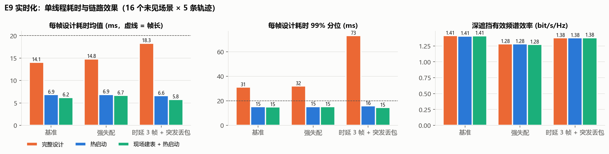

**结论：**
- 实时化不需要离线、按场景准备的查找表。热启动只依赖当前信道模型，换场景直接可用，效果与完整设计没有可分辨的差别。
- 现场建表的作用是让第一帧和重捕获后的那一帧更快：几何变了就在后台重建，几秒内完成。
- 以上计时来自 Python 加 numpy。换成编译语言或 GPU 实现后，余量会更大。

## 4. 仍然存在的局限

1. **只有仿真**：全部是二维标量仿真加代理模型。E6 只验证了校准流程本身，第 3 项缺口需要真实测量数据才能真正补上。
2. **计算速度**：纯相位设计已经用热启动做到实时（E9），每帧平均约 7 ms，99% 分位约 15 ms。在线 Airy 仍然较慢，每次约 50 ms 以上，大孔径时更慢，没有做实时化。第一帧和几何变化后的那一帧仍需 13–28 ms。
3. **几何失配**：静态的稳健设计在几何失配时仍有 −15% 到 −24% 的 5% 分位，要靠闭环测量来弥补。几何误差超出假设范围时（强失配），深遮挡效率与真实位置参照仍差 14%。
4. **补扫门限**：时延较大时补扫比例过高（时延 3 帧时 62%–68%），门限应随时延自适应。
5. **验证效果有限**：帧内验证的收益很小，强失配下还偶尔选错，值得改成按后验不确定度决定是否验证。
6. **被动定位的代价**：数据波形回波模式的定位误差略高于每帧专用照射。
7. **孔径实验的范围**：E8 只用了二维标量模型和 16 个场景，障碍物宽 8–10 cm。没有覆盖 1 m 级孔径和 z/D > 15 的远距离（相关文献中 Single→Multi-Airy 等工作的设置）。E8b 只比较了 3 个孔径，没有包含非协作感知。纯相位在大电尺寸、近距离时只拿到幅相上界的 30%–50%，振幅可调的硬件在这类设置下还有较大潜力，本项目没有建模这类硬件的代价。

## 5. 复现

```powershell
python -m tests
python -m nfbeam.experiments.e1_known_position
python -m nfbeam.experiments.e2_robustness
python -m nfbeam.experiments.e3_cooperative
python -m nfbeam.experiments.e4_same_waveform
python -m nfbeam.experiments.e5_feedback_delay_loss
python -m nfbeam.experiments.e6_calibration
python -m nfbeam.experiments.e7_link_budget
python -m nfbeam.experiments.e8_aperture
python -m nfbeam.experiments.e8b_aperture_link
python -m nfbeam.experiments.e9_realtime
python -m nfbeam.plots
```

在 24 核机器上并行运行（最多 12 个进程），E3、E4、E5 各约 25 分钟，E8、E9 也需要数十分钟。E9 的计时请在机器空闲时运行。`e8_aperture --summarize-only` 可以只从已保存的逐位置结果重算汇总；`e9_realtime --scaling-only` 只重测阵元数扩展那一组。逐帧结果在 `nfbeam/results/e*/frames.csv.gz`，汇总在各自的 `summary.json`。
