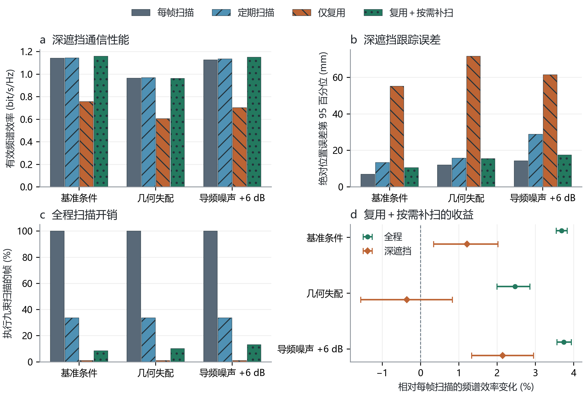

# 复用通信导频的 Airy 波束跟踪实验

2026 年 11 月 18 日

在 16 个留出场景的基准仿真中，**复用通信导频并按需补扫**只在 **8.51%** 的帧执行九束扫描，全程有效频谱效率相对每帧扫描提高 **3.68%**。深遮挡区提高 **1.22%**，代价是平均位置误差由 **2.41 mm** 增至 **3.70 mm**。初始扫描后只靠通信导频会出现长时间跟踪中断。障碍物几何失配后，复用加补扫在深遮挡下的收益区间跨过零。

## 帧内通信与位置更新

接收机采用 4 个子孔径输出。从每帧用于信道估计的参考符号估计四路幅值，并利用其相对形状匹配横向位置。算法拟合一个公共幅值因子以处理未知整体信号强度。位置的纵向坐标和障碍物名义几何来自场景配置。模板搜索会利用卡尔曼跟踪器的预测窗口。信号低于门限，或四路响应无法在窗口内排除相隔较远的候选位置时，本帧跳过测量更新。

普通通信帧根据上一帧状态预测波束位置。接收机测量本帧参考符号，发送位置和有效性反馈，更新用于下一帧的跟踪状态。扫描帧在载荷之前执行九束扫描及反馈，位置更新可以用于当帧载荷。两类帧均使用已训练的跨场景网络选择 Airy 波束参数，或根据遮挡程度切换到常规聚焦波束。

| 方法 | 位置测量与重捕获 |
| --- | --- |
| 每帧扫描 | 每帧先扫 9 束，再用测得的位置发数据 |
| 定期扫描 | 每隔 3 帧扫 9 束，其他帧由跟踪器外推 |
| 仅复用 | 首帧扫 9 束，后续用通信导频更新 |
| 复用＋按需补扫 | 首帧扫 9 束，随后复用通信导频。连续两帧无可用测量时，下一帧扫 9 束 |

四种方法使用相同的 20 ms 帧长、归一化带宽和发射功率预算。每帧都预留 0.10 ms 通信参考符号和 0.10 ms 反馈或控制。触发九束扫描时额外占 0.90 ms，因此数据时间比例为 94.5%，常规帧为 99.0%。扫描、参考符号和载荷都按发射端相同单位时长能量计，控制时隙在各组采用相同预算。有效频谱效率按数据时间比例乘以 `log₂(1 + SNR)` 计算。仿真在四个子孔径上用传播功率构造带噪观测，并加入公共增益变化和一个相干附加分量。反馈假定在预留时隙内成功到达。

每个条件使用 16 个留出几何场景，每场景 5 条运动轨迹，每条 101 帧。四种方法共用相同的轨迹及配对随机噪声。深遮挡按真实几何遮挡比例至少 80% 划分。表中的绝对指标按帧汇总，百分比变化按场景等权、对 16 个场景配对重采样获得 95% 区间。



## 实验 1 · 基准条件下的跟踪与通信

| 方法 | 全程扫描帧 | 全程效率 | 深遮挡效率 | 深遮挡位置 MAE | 深遮挡位置 P95 | 深遮挡最长更新间隔均值 |
| --- | ---: | ---: | ---: | ---: | ---: | ---: |
| 每帧扫描 | 100.00% | 2.156 | 1.143 | 2.41 mm | 6.94 mm | 20.5 ms |
| 定期扫描 | 33.66% | 2.183 | 1.144 | 4.94 mm | 13.42 mm | 70.8 ms |
| 仅复用 | 0.99% | 1.571 | 0.758 | 17.68 mm | 55.19 mm | 497.3 ms |
| 复用＋按需补扫 | 8.51% | 2.235 | 1.160 | 3.70 mm | 10.64 mm | 51.5 ms |

效率单位为 bit/s/Hz。最长更新间隔按每次运行中深遮挡内连续缺少可用位置测量的时长取最大值，再跨运行平均。定期扫描的未测量帧也计入间隔。

**分析。** 仅复用在深遮挡只有 25.72% 的帧接受位置测量，相对每帧扫描的场景平均效率下降 31.28%。连续失去更新会使位置偏差累积，偏离的通信束也可能为下一帧提供更弱的定位观测。按需补扫将深遮挡可用测量比例恢复至 57.32%，最长缺少更新时长从 1.12 s 降到 180 ms。相对每帧扫描，复用加补扫在深遮挡的效率提升为 **1.22%**（95% 区间 **[0.35%, 2.02%]**），其他位置提升 **4.20%**。相对定期扫描，复用加补扫的全程效率提升 **2.39%**，深遮挡提升 **1.44%**，且深遮挡跟踪误差更低。每帧扫描仍具有最低的跟踪误差。

## 实验 2 · 障碍物真值与位置模板失配

观测和载荷传播的障碍物中心横移 3 mm，宽度增加 5%。波束网络和模板继续使用名义几何。四组采用同一套真实几何判断深遮挡。

**分析。** 复用加补扫对每帧扫描的全程效率提高 **2.47%**（95% 区间 **[2.00%, 2.86%]**），深遮挡效率变化为 **−0.36%**（**[−1.56%, 0.84%]**）。相对定期扫描，深遮挡变化为 **−0.51%**（**[−1.84%, 0.88%]**）。深遮挡下，复用加补扫的 MAE 为 5.30 mm，高于每帧扫描的 4.03 mm。几何误差会同时改变通信束的覆盖和用于测位的幅值模板，压缩深遮挡区域内减少扫描所能节约的收益。

## 实验 3 · 导频噪声功率增加 6 dB

只提高定位观测的导频噪声功率至 4 倍，数据噪声保持相同。因而该实验衡量的是估计质量下降通过波束跟踪传递到通信的影响。

**分析。** 复用加补扫在深遮挡中把扫描帧比例从基准条件的 20.57% 提高到 32.83%，深遮挡的跟踪 MAE 由 3.70 mm 增至 5.66 mm。相对每帧扫描，深遮挡有效频谱效率仍提高 **2.15%**（95% 区间 **[1.34%, 2.95%]**）。这个收益依赖额外的重捕获扫描和本模型的开销设定。仅复用在该条件下深遮挡效率降为 0.704 bit/s/Hz。

## 仿真的适用范围与复现

本实验检验接收机能测量四个子孔径、并能通过控制时隙反馈的协作链路。频谱效率是传播和噪声模型下的估算值。模型把参考符号接收抽象为相关后的带噪幅值，未建模 OFDM 同步、子阵幅相校准和反馈丢包。被动场景中的同波形双程回波定位需要单独建模接收泄漏、障碍物杂波和有效回波带宽。

```powershell
python -m direct_network.experiments.evaluate_pilot_reuse
python -m direct_network.plots.plot_pilot_reuse
```

[逐帧数据](../direct_network/results/pilot_reuse/frames.csv) · [汇总与配对区间](../direct_network/results/pilot_reuse/summary.json) · [矢量图](../direct_network/figures/pilot_reuse_comparison.svg)
